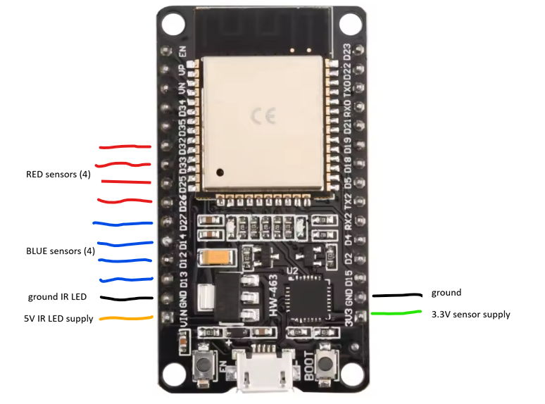

# 2026_Scoreboard
Arduino ESP32 project for Scoreboard counter 

## Required Hardware
ESP32 development board

## Required Software
Arduino development environment with ESP32 boards package

## Hardware pin allocation

  4 light beam sensors per goal, 2 goals
  each light beam sensor is mounted in an individual object channel, count objects individually
  4 object channels run in parallel per goal

  Input-Only Pins: Pins like GPIO 34-39 are input-only and do not feature internal pull-up or pull-down resistors, but they still support external interrupts if you provide proper external circuitry.
  Restricted Pins: Avoid using pins tied to flash memory or integrated SPI/boot functions (like GPIO 6–11) for general user interrupts.



```
// Define the sensor pin (ensure it supports interrupts)
// - single line of inputs, starting next to Vin, GND:
// Blue side: 4 sensors
#define SENSOR_PIN_B1   13
#define SENSOR_PIN_B2   12
#define SENSOR_PIN_B3   14
#define SENSOR_PIN_B4   27
// Red side: 4 sensors
#define SENSOR_PIN_R1   26
#define SENSOR_PIN_R2   25
#define SENSOR_PIN_R3   33
#define SENSOR_PIN_R4   32
```
